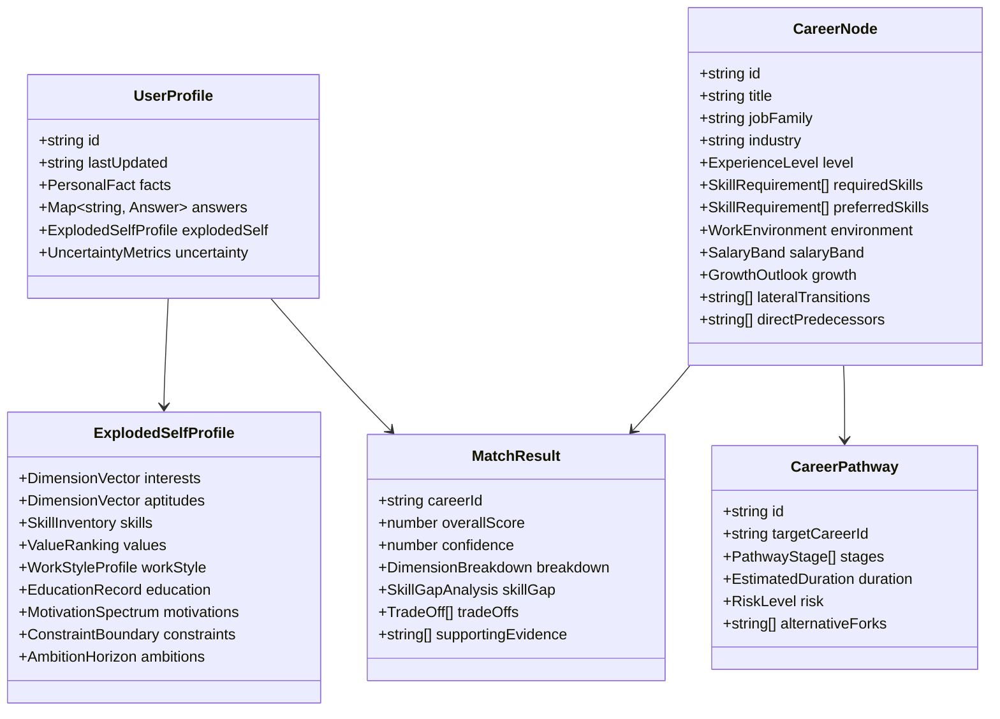

# CAREER PILOT — SYSTEM ARCHITECTURE SPECIFICATION
**Version:** 1.0.0  
**Status:** Approved Architecture Baseline  
**Author:** Principal Software Architect & Systems Engineer  

---

## 1. System Vision & Foundational Philosophy

Career Pilot is an exploratory instrument designed to deconstruct personal characteristics into structured, interactive dimensions and construct explainable, non-deterministic career pathways.

### Core Distinctions
1. **Not a Generic Chatbot:** The core experience is driven by spatial, visual instruments and structured graph algorithms, not conversational text walls.
2. **Deterministic & Explainable:** Matches are computed from explicit vector overlaps, skill compatibility trees, value harmonies, and trade-off matrices.
3. **Zero Paid-API Dependency (Local-First MVP):** Operates 100% offline with zero external API requirements. User profile and state remain private in browser memory and local storage.
4. **Signature Visual Paradigm ("The Exploded Self"):** Rather than tabular cards or SaaS templates, the user profile is visualized as a technical exploded-view assembly with 9 spatially separated, interactive layers.

---

## 2. Technical Stack

| Tier | Technology | Purpose |
| :--- | :--- | :--- |
| **Runtime & Bundler** | Node.js 24 + Vite 8 | Ultra-fast HMR and optimized tree-shaken production builds |
| **Language** | TypeScript 5.8+ (Strict Mode) | End-to-end type safety across question graphs, matching, and pathways |
| **View Layer** | React 19 | Declarative UI, Concurrent rendering, modular component trees |
| **Styling & Tokens** | Tailwind CSS v4 + Design Tokens | Custom technical-editorial palette, fine hairline borders, grid overlays |
| **Motion & Physics** | Framer Motion + Canvas/SVG | Spring physics, spatial layer deconstruction, connecting ray diagrams |
| **Icons & Glyphs** | Lucide React | Precision 1px/1.5px technical iconography |
| **Storage & State** | React Context + LocalStorage Engine | Local-first state persistence, versioned JSON export/import, atomic wipe |

---

## 3. Visual Design System & Aesthetics

### 3.1 Aesthetic Anchor: Technical-Editorial Instrument
The aesthetic is inspired by exploded technical schematics, astronomical instruments, and precision editorial layouts.

- **Background:** Deep obsidian / midnight graphite (`#080A0D`, `#0E1217`, `#151A21`).
- **Hairline Precision:** `1px` borders with subtle opacities (`rgba(255, 255, 255, 0.08)` to `0.15`).
- **Accent Telemetry:**
  - `Precision Cyan` (`#00F0B4`): Verified facts, optimal paths, high compatibility.
  - `Signal Amber` (`#F59E0B`): Trade-offs, skill gaps, risk indicators, uncertainty.
  - `Deep Violet` (`#8B5CF6`): Latent aptitudes, exploratory branches, long-term horizon.
- **Typography:**
  - **Headings & Editorial Accents:** *Instrument Serif* / *Cinzel* for gravitas and editorial clarity.
  - **Body & Controls:** *Inter* for legible, neutral clarity.
  - **Telemetry & Metadata:** *JetBrains Mono* for coordinates, score vectors, and system tags.

---

## 4. Domain Data Model & Core Schemas

### 4.1 The 9 Dimensions of the Exploded Self
1. **Interests & Curiosity:** Intellectual domains, intrinsic inquiry topics, hobbyist depth.
2. **Aptitudes & Cognitive Style:** Spatial, analytical, verbal, systemic, creative processing.
3. **Demonstrated Skills:** Verifiable competencies across hard technical and foundational transferable domains.
4. **Work Style & Environment:** Collaboration density, autonomy requirements, physical/remote pace.
5. **Values & Motivations:** Impact vs. status vs. autonomy vs. stability vs. mastery.
6. **Financial & Lifestyle Requirements:** Target compensation, acceptable floor, time commitment, geographic constraints.
7. **Educational Background & Credentials:** Current certifications, degrees, informal training.
8. **Risk Tolerance & Uncertainty:** Appetite for variance, startup vs. institutional, willingness to retrain.
9. **Ambitions & Horizon:** 3-to-10-year aspirations (leadership, technical specialist, founder, portfolio career).

---

## 5. Computation Engine Architecture

### 5.1 Adaptive Branching Engine
- Questions are organized in 9 dimensional modules.
- Evaluates answer weights in real-time to compute `branchTriggers`.
- If an answer indicates high divergence or conflicting signals (e.g. high analytical + high artistic), conditional calibration questions are injected.
- Calculates an **Uncertainty Score** per dimension. If a dimension has high variance, targeted probe questions are offered.

### 5.2 Career Knowledge Graph
A directed acyclic graph (DAG) and relational network connecting:
- `Occupation` nodes (Entry, Mid, Senior, Principal, Executive).
- `Skill` nodes with dependency hierarchies (e.g., Python -> Pandas -> Feature Engineering).
- `Industry` and `Environment` tags.
- `Transition Edges` with weight based on transferable skill overlap.

### 5.3 Explainable Matching Engine
Computes multidimensional cosine and weighted Euclidean distance:
$$\text{Score} = w_i \cdot S_{\text{interests}} + w_s \cdot S_{\text{skills}} + w_v \cdot S_{\text{values}} + w_w \cdot S_{\text{workstyle}} - P_{\text{friction}}$$
Crucially, every score produces an **Explanation Payload**:
- **Why it fits:** Exact intersecting vector components.
- **Skill delta:** What you have vs. what is missing.
- **Frictions:** Stated constraints that conflict with industry realities (e.g. desiring high remote flexibility in high-security hardware lab roles).
- **Confidence metric:** Factored by depth of user answers in that domain.

### 5.4 Dynamic Pathway Engine
Given a user's starting profile and target career:
1. Performs topological sort on skill dependencies to find the shortest viable learning and progression path.
2. Generates multi-stage route:
   - *Stage 1: Grounding & Skill Acquisition* (target high-leverage transferable skills).
   - *Stage 2: Proof & Portfolio Milestones* (actionable, non-trivial demonstration projects).
   - *Stage 3: Entry / Lateral Gateway* (identifies realistic entry points or adjacent transitions).
   - *Stage 4: Core Specialization* (deepening mastery in the chosen trajectory).
   - *Stage 5: High-Impact Horizon* (long-term strategic elevation).

---

## 6. Security, Local-First Persistence & Privacy

- **Data Ownership:** All responses, assessments, and pathways are stored in client-side storage (`localStorage` / IndexedDB).
- **Export & Import:** 1-click JSON cryptographic export with schema versioning.
- **Atomic Purge:** Immediate zeroization of all stored profile data with client confirmation.
- **No Unconsented Telemetry:** No third-party trackers, no hidden analytics, zero transmission of personal answers to third-party endpoints.
