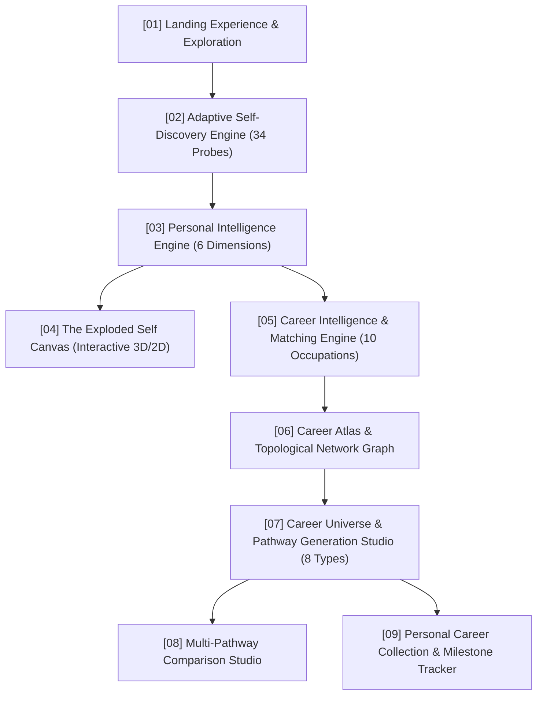

# CAREER PILOT — SYSTEM MANUAL & ARCHITECTURAL SPECIFICATION

```
  ____    _    ____  _____ _____ ____    ____ ___ _     ___ _____ 
 / ___|  / \  |  _ \| ____| ____|  _ \  |  _ \_ _| |   / _ \_   _|
| |     / _ \ | |_) |  _| |  _| | |_) | | |_) | || |  | | | || |  
| |___ / ___ \|  _ <| |___| |___|  _ <  |  __/| || |__| |_| || |  
 \____/_/   \_\_| \_\_____|_____|_| \_\ |_|  |___|_____\___/ |_|  
```

> **A deterministic, evidence-linked career discovery, personal intelligence, and strategic pathway engine.**
> *Zero generic chatbot responses. Zero ungrounded personality quizzes. 100% explainable, local-first architecture.*

---

## 1. Product Vision & Architectural Principles

Career Pilot moves beyond shallow keyword matching and generic career recommendation algorithms. It helps individuals deconstruct their cognitive characteristics, explore real-world occupations grounded in international labor standards, and generate actionable, validated transition pathways.

### Core Architectural Guarantees:
1. **100% Deterministic & Local-First**: Zero reliance on external paid AI APIs (OpenAI, Anthropic, Gemini). All scoring, graph traversals, and profile generations execute in-browser with zero latency and zero data leakage.
2. **Explainable & Evidence-Linked**: Recommendations cite exact user responses, demonstrated accomplishments, and verified capabilities.
3. **Multi-Classification Standard Provenance**: Occupations are cross-indexed to **O*NET v29.1** (US Department of Labor), **ESCO v1.2** (European Commission), and **NCO-2015** (Ministry of Labour & Employment, India).
4. **Graph-Backed Pathway Validation**: Pathways are constructed from a multi-entity knowledge graph and verified against structural invariants (cycle prevention, prerequisite ordering, dead-end detection, geographic compliance).
5. **Technical-Editorial Visual Identity**: Art-directed design system inspired by engineering telemetry consoles (Obsidian `#080A0D`, Precision Cyan `#00F0B4`, Signal Amber `#F59E0B`, hairline 1px borders, and JetBrains Mono typography).

---

## 2. System Architecture & Complete User Journey

The platform connects 6 integrated engines across a unified user journey:



---

## 3. The Five Major Application Modules

### `[01] Discover` — Adaptive Self-Discovery Engine
- **34 Core Inquiries** distributed across 9 dimensions:
  - Interests & Curiosity (5)
  - Aptitudes & Natural Strengths (5)
  - Existing Skills & Experience (4)
  - Work Preferences (4)
  - Values & Motivations (4)
  - Lifestyle & Environment (3)
  - Education & Learning (3)
  - Personal Constraints (3)
  - Ambitions & Risk Tolerance (3)
- **Conditional Follow-up Engine**: Up to 6 clarification probes triggered by uncertainty, conflict, or exploratory assertions. Strictly capped at $\le 40$ questions.
- **Multi-Format Input Interfaces**: Single choice, multi-select, priority ranking, dual-polarity continuous sliders, proportional 100% allocation, and forced trade-off cards.

### `[02] My Profile` — Personal Intelligence Workspace
- **The Exploded Self Canvas**: Signature interactive visualization featuring a central cognitive core and 6 floating intelligence dimension plates with isometric 3D tilt, expansion controls, and live telemetry rays.
- **Six Intelligence Dimensions**:
  1. `interestIntelligence` (`INTEL-01`): Primary, secondary, and emerging curiosity domains.
  2. `abilityIntelligence` (`INTEL-02`): Demonstrated vs. potential cognitive strengths.
  3. `skillIntelligence` (`INTEL-03`): Verified capability inventory across venues.
  4. `workIntelligence` (`INTEL-04`): Environmental polarities (autonomy, pacing, collaboration).
  5. `valuesIntelligence` (`INTEL-05`): Core persistence motivators and deal-breakers.
  6. `growthIntelligence` (`INTEL-06`): Credential baseline, financial runway, and time constraints.
- **Evidence Traceability & Overrides**: Every inferred signal links directly to source prompts and answers. Users can confirm, refine, reject signals, or add custom verified skills.

### `[03] Career Atlas` — Career Intelligence & Topological Universe
- **Career Universe Network**: Interactive SVG network visualizing connections between the user nucleus, accredited education nodes, core skill nodes, bridge roles, and target destinations.
- **Six Recommendation Categories**: Direct Matches, Adjacent Matches, Interdisciplinary, Unexpected Discovery, Aspirational, and Alternative Directions.
- **Deep Inspection Drawer**: Explains *Why it matches*, *What might be difficult*, *What the user has*, *What the user needs*, and multi-currency compensation envelopes (USD, EUR, INR).

### `[04] My Pathways` — Strategic Pathway Generation Studio
- **Eight Distinct Pathway Categories**:
  - `Type A`: Direct Academic Pathway
  - `Type B`: Skill-Based Accelerated Pathway
  - `Type C`: Alternative Education Pathway (Bootcamps & Industry Certifications)
  - `Type D`: Bridge Career Pathway (Intermediary Stepping-Stone Roles)
  - `Type E`: Interdisciplinary Pathway (Dual-Domain Synthesis)
  - `Type F`: Earn-While-Learning Pathway (Apprenticeships & Income Preservation)
  - `Type G`: Long-Term Specialization Pathway (Doctoral/Principal Trajectories)
  - `Type H`: Career Transition Pathway (Lateral Transferable Pivots)
- **Pathway Comparison Studio**: Side-by-side technical evaluation of 2–3 routes with cost/time deltas.
- **Personal Career Collection**: Persistent milestone tracking, pin/unpin focus controls, and skill acquisition logs.

### `[05] Compare` — Multi-Career Trade-Off Studio
- Side-by-side technical comparison of 2–3 occupations.
- **Priority Lens Simulator**: Instant re-ranking across 6 evaluation lenses (Balanced, Max Compensation, Max Autonomy, Max Remote, Low Entry Barrier, Values & Impact).
- Dimensional Advantage & Delta analysis table with winner indicators.

---

## 4. Technology Stack & Directory Structure

```
career-path/
├── scripts/                  # Presentation handbook & PDF compilation scripts
├── public/                   # Static assets & custom branded favicon
├── src/
│   ├── components/
│   │   ├── assessment/       # Adaptive questionnaire & input format controls
│   │   ├── atlas/            # SVG Career Universe topological network graph
│   │   ├── common/           # Header, Modal, TechCard, ErrorBoundary, BespokeIcons
│   │   ├── destinations/     # DiscoveryView, ProfileView, AtlasView, PathwaysView, CompareView, RoadmapView
│   │   ├── exploded-self/    # Exploded Self 3D/2D Canvas & dimension panels
│   │   └── profile/          # Intelligence dossier, conflict cards, skill manager
│   ├── context/              # CareerPilotProvider, state management, custom hooks
│   ├── data/
│   │   ├── graph/            # Knowledge graph nodes (education, skills, bridges, edges)
│   │   ├── occupations/      # 10 authoritative occupations (O*NET, ESCO, NCO)
│   │   └── questionBank.ts   # 34 core probes + 6 conditional follow-ups
│   ├── engine/
│   │   ├── career/           # 6-D matching engine & occupation comparison
│   │   ├── graph/            # Graph database, pathway generation, validation, ranking
│   │   ├── profile/          # Signal extraction, conflict detection, evidence manager
│   │   └── branchingEngine.ts# Question branching & uncertainty quotient
│   ├── styles/               # Design system tokens and styling
│   ├── types/                # Strongly-typed schemas (assessment, careerGraph, occupation, profile)
│   ├── utils/                # LocalStorage enclave, JSON import/export, sanitization
│   ├── App.tsx               # Root component with code-splitting & lazy loading
│   └── main.tsx              # Application entrypoint
├── CAREER_PILOT_USER_GUIDE_AND_PRESENTATION_HANDBOOK.md # Complete user & presentation guide (~5,900 words)
├── Career_Pilot_Complete_User_Guide_and_Presentation_Handbook.pdf # PDF handbook deliverable
├── CAREER_PILOT_LIVE_PRESENTATION_NAVIGATOR.md # Screen-by-screen field navigator
├── Career_Pilot_Live_Presentation_Navigator_and_Visual_Field_Guide.pdf # PDF navigator deliverable
├── ARCHITECTURE.md           # Technical architecture specification
├── DEPLOYMENT.md             # Production deployment & operations guide
├── ROADMAP.md                # Phase-by-phase implementation record
├── vite.config.ts            # Optimized Vite build with manual chunks
└── package.json
```

---

## 5. Getting Started & Installation

### Prerequisites
- Node.js version 18.0.0 or higher
- npm version 9.0.0 or higher

### Local Development Setup
```bash
# 1. Clone repository
git clone https://github.com/example/career-pilot.git
cd career-pilot

# 2. Install dependencies
npm install

# 3. Start local development server
npm run dev

# Application will be accessible at: http://localhost:5173/
```

### Development Scripts
| Command | Action |
|---|---|
| `npm run dev` | Starts Vite local development server with Hot Module Replacement |
| `npm run build` | Compiles production bundle with TypeScript type-checking (`tsc -b && vite build`) |
| `npm run lint` | Runs `oxlint` static code analysis across all workspace files |
| `npm test` | Launches Vitest in watch mode |
| `npm test -- --run` | Executes complete automated test suite once and outputs results |
| `npm run preview` | Serves the production `/dist` build locally for verification |

---

## 6. Automated Test Suite

Career Pilot includes 63 comprehensive unit, integration, and end-to-end tests across 5 test suites:

```bash
npm test -- --run
```

```
✓ src/engine/__tests__/branchingEngine.test.ts (12 tests)
  - Verifies exact 34 core questions and dimension distribution
  - Verifies conditional follow-up triggers and priority anchor placement
  - Verifies max 40 question queue cap and dynamic recomputation on answer edits

✓ src/engine/profile/__tests__/profileEngine.test.ts (10 tests)
  - Verifies 6 intelligence dimensions and evidence traceability
  - Verifies uncertainty quotient computation and structural tension detection
  - Verifies signal confirmation, user refinement, and override preservation

✓ src/engine/career/__tests__/careerMatchingEngine.test.ts (16 tests)
  - Verifies 6-dimensional matching mathematics and category assignment
  - Verifies 10 representative user scenarios from Section 12
  - Verifies explainability generation and multi-career comparison

✓ src/engine/graph/__tests__/pathwayEngine.test.ts (12 tests)
  - Verifies structural pathway validation (cycle detection, dead-end elimination)
  - Verifies prerequisite ordering and valid stage transition rules
  - Verifies canonical fingerprint deduplication and ranking lenses

✓ src/engine/__tests__/endToEndJourney.test.ts (13 tests)
  - Persona 1: Student with limited professional experience
  - Persona 2: Career changer from traditional IT to Cloud Systems
  - Persona 3: Interdisciplinary explorer (Biology + Computer Science)
  - Persona 4: Income and stability prioritizer
  - Persona 5: Unconventional career seeker (Creative Technology)
  - Persona 6: High financial & educational constraints user
  - Persona 7: Unclear preferences and high ambiguity user
  - Persona 8: Experienced operator with deep transferable skills
  - Security sanitization on profile JSON import
  - Graph telemetry and reproducible pathway synthesis

Test Files: 5 passed (5)
Tests:      63 passed (63)
Duration:   ~240ms
```

---

## 7. Performance & Bundle Optimization

Vite build optimizations with dynamic `React.lazy` code-splitting and rollup chunking produce an ultra-lean bundle:

```
dist/index.html                                     1.20 kB │ gzip:  0.60 kB
dist/assets/index-*.css                            63.90 kB │ gzip: 10.56 kB
dist/assets/vendor-icons-*.js                      23.27 kB │ gzip:  8.60 kB
dist/assets/AtlasView-*.js                         37.32 kB │ gzip:  8.47 kB
dist/assets/CompareView-*.js                       17.38 kB │ gzip:  5.07 kB
dist/assets/DiscoveryView-*.js                     51.54 kB │ gzip: 12.39 kB
dist/assets/ProfileView-*.js                       60.82 kB │ gzip: 12.34 kB
dist/assets/PathwaysView-*.js                      96.67 kB │ gzip: 22.38 kB
dist/assets/index-*.js                            105.30 kB │ gzip: 32.61 kB
dist/assets/vendor-react-*.js                     210.90 kB │ gzip: 65.85 kB
```

Initial page load transfers only ~105 kB of application logic. Heavy destination views load asynchronously upon navigation.

---

## 8. Security & Data Sovereignty

- **Enclave Architecture**: All user responses and computed intelligence profiles reside strictly in HTML5 LocalStorage (`career_pilot_profile_v1`). Zero data is transmitted to remote databases.
- **Zero Third-Party Telemetry**: No trackers, analytics beacons, or remote logging.
- **Sanitized Import**: The `importProfileJson` engine guards against prototype pollution (`__proto__`, `constructor`) and sanitizes string inputs to prevent XSS.
- **User Rights**: Users can audit storage usage via the **[Enclave]** dialog, export a JSON archive via **[Export]**, or permanently zeroize their local storage via **[Reset]**.

---

## 9. Status of Features & Known Limitations

| Capability | Implementation Status | Verification Notes |
|---|---|---|
| **Adaptive 34-Question Assessment** | Complete & Verified | 34 core probes + 6 conditional follow-ups; tested under Vitest |
| **Personal Intelligence Engine** | Complete & Verified | 6 dimensions, evidence traceability, signal overrides |
| **The Exploded Self Visualization** | Complete & Verified | 3D/2D perspective, expansion slider, inspection panel |
| **Authoritative Occupation Database** | Complete & Verified | 10 deep representative occupations linked to O*NET, ESCO, NCO |
| **Explainable Career Matching** | Complete & Verified | 6 weighted dimensions, transparent reasons & difficulties |
| **Career Universe Graph** | Complete & Verified | 6 node types, 13 edge types, topological SVG network |
| **Dynamic Pathway Generation** | Complete & Verified | All 8 pathway categories synthesized deterministically |
| **Pathway Validation Engine** | Complete & Verified | Cycle detection, prerequisite ordering, dead-end detection |
| **Pathway Comparison Studio** | Complete & Verified | Side-by-side evaluation of up to 3 pathways with trade-offs |
| **Personal Milestone Tracker** | Complete & Verified | Saved routes, milestone status tracking, pin toggles |
| **Client-Side Enclave & Security** | Complete & Verified | Local storage, zero telemetry, export/import/purge |
| **Real-time Live Job Postings** | Not Implemented (By Design) | Career Pilot evaluates occupational trajectories; it is not a job board |
| **Server-Side Account Synchronization** | Not Implemented (By Design) | Operates 100% client-side for zero-leakage privacy |

---

## 10. Deployment

See [`DEPLOYMENT.md`](file:///c:/Users/User/OneDrive/Desktop/Python/akka/career%20path/DEPLOYMENT.md) for complete instructions covering Vercel, Netlify, Cloudflare Pages, Nginx, and Docker containerization.

---

*Career Pilot v1.0 Production Release · Built with React 19, TypeScript, Vite & Tailwind CSS.*
