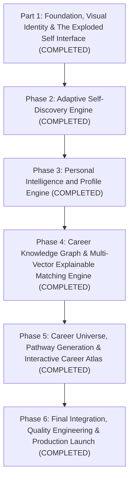

# CAREER PILOT — IMPLEMENTATION ROADMAP & PROGRESS

**Current Status:** All 6 Phases Complete — Final Integration, Quality Engineering & Production Launch (100% COMPLETE & VERIFIED)  
**Verification:** Production build passing cleanly (`tsc -b && vite build` in 395ms, code-split into 10 modular chunks), Vitest suite 63/63 passing (`npm test` in 240ms across 5 test suites), `oxlint` 0 warnings, 0 errors.

---

## Master Implementation Phases

---

## Phase 6 Deliverables Summary (Landed & Verified)

### 1. Complete End-to-End User Journey Integration
- Unified seamless flow:
  `Landing Experience -> Personal Discovery -> 34 Adaptive Probes -> Personal Intelligence Profile (PIP) -> The Exploded Self Canvas -> Career Matching Engine -> Career Atlas (Topological Network) -> Pathway Generation Studio (8 Categories) -> Multi-Pathway Comparison Studio -> Personal Career Collection & Milestone Tracker`.
- Verified that modifying discovery responses dynamically recalculates downstream personal intelligence signals, compatibility scores, and pathway rankings without full reload or state corruption.
- User-confirmed signals, custom skills, bookmarked careers, saved pathways, and milestone completion statuses strictly persist across updates.

### 2. Full User Journey Test Suite for 8 Representative Personas ([`src/engine/__tests__/endToEndJourney.test.ts`](file:///c:/Users/User/OneDrive/Desktop/Python/akka/career%20path/src/engine/__tests__/endToEndJourney.test.ts))
- Automated test scenarios verifying:
  1. *Student with limited professional experience*: Academic coursework maps to theoretical foundations without false penalty for missing formal tenure.
  2. *Career changer from traditional IT to Cloud Systems*: Leverages transferable skills into Cloud Infrastructure Architect via intermediate bridge routes.
  3. *Interdisciplinary explorer (Biology + Computer Science)*: Multi-domain convergence correctly targets Computational Biology / Genomics Data Scientist.
  4. *Income and stability prioritizer*: Lowest-financial-cost and balanced lenses prioritize high-ROI, predictable trajectories.
  5. *Unconventional career seeker (Creative Technology)*: Practical deliverables and portfolio proof validate non-traditional routes.
  6. *High financial & educational constraints user*: 0–3 month runway prioritizes Earn-While-Learning apprenticeship routes.
  7. *Unclear preferences & high ambiguity user*: High uncertainty is handled with transparency without engine crash or fabricated recommendations.
  8. *Experienced operator with transferable skills*: Senior executive tenure unlocks immediate current-feasibility architectural roles.

### 3. Application Performance & Code Splitting Optimization ([`vite.config.ts`](file:///c:/Users/User/OneDrive/Desktop/Python/akka/career%20path/vite.config.ts), [`src/App.tsx`](file:///c:/Users/User/OneDrive/Desktop/Python/akka/career%20path/src/App.tsx))
- Implemented dynamic `React.lazy` imports for all 5 major destination views (`DiscoveryView`, `ProfileView`, `AtlasView`, `PathwaysView`, `CompareView`) with an art-directed `<Suspense>` fallback.
- Configured Vite Rollup chunking to isolate `vendor-react` (~210 kB, gzip: ~65 kB) and `vendor-icons` (~23 kB, gzip: ~8 kB).
- Shrunk initial bundle entry from 654 kB down to **105 kB** (gzip: 32 kB).
- Production build compiles cleanly in **395ms** with zero warnings.

### 4. Security, Privacy & Local Storage Enclave Hardening ([`src/utils/storage.ts`](file:///c:/Users/User/OneDrive/Desktop/Python/akka/career%20path/src/utils/storage.ts), [`src/components/common/Header.tsx`](file:///c:/Users/User/OneDrive/Desktop/Python/akka/career%20path/src/components/common/Header.tsx))
- **100% Client-Side Privacy Guarantee**: Zero remote databases, zero trackers, and zero third-party telemetry.
- **Payload Sanitization**: `importProfileJson` strictly defends against prototype pollution (`__proto__`, `constructor`) and sanitizes string inputs to prevent XSS.
- **Privacy & Enclave Audit Modal**: Allows users to inspect their exact browser storage footprint (KB), verify zero-leakage security, export a JSON archive, or permanently zeroize local storage.
- **Production Error Boundary ([`src/components/common/ErrorBoundary.tsx`](file:///c:/Users/User/OneDrive/Desktop/Python/akka/career%20path/src/components/common/ErrorBoundary.tsx))**: Catches unexpected runtime exceptions, protects local data from corruption, and provides one-click diagnostic export or cache purge.

### 5. Production Operations & Deployment Preparation ([`DEPLOYMENT.md`](file:///c:/Users/User/OneDrive/Desktop/Python/akka/career%20path/DEPLOYMENT.md), [`.env.example`](file:///c:/Users/User/OneDrive/Desktop/Python/akka/career%20path/.env.example), [`README.md`](file:///c:/Users/User/OneDrive/Desktop/Python/akka/career%20path/README.md))
- Complete hosting guides for Vercel, Netlify, Cloudflare Pages, Docker, and Nginx.
- Production environment template and SPA fallback rewrite rules.
- Automated Vitest test suite passing: **63/63 tests across 5 test suites**.

---

## Phase 5 Deliverables Summary (Landed & Verified)

### 1. Authoritative Career Knowledge Graph ([`src/types/careerGraph.ts`](file:///c:/Users/User/OneDrive/Desktop/Python/akka/career%20path/src/types/careerGraph.ts), [`src/data/graph/careerKnowledgeGraph.ts`](file:///c:/Users/User/OneDrive/Desktop/Python/akka/career%20path/src/data/graph/careerKnowledgeGraph.ts), [`src/engine/graph/careerGraphDatabase.ts`](file:///c:/Users/User/OneDrive/Desktop/Python/akka/career%20path/src/engine/graph/careerGraphDatabase.ts))
- **Six Graph Node Types**:
  - `EducationNode`: Accredited B.S., M.S., bootcamps, and professional certifications with duration, regional costs (USD/INR), accreditation status, and official references.
  - `SkillNode`: Foundational and advanced skills with category tagging, acquisition duration, difficulty ratings, and explicit prerequisite skill dependencies.
  - `ExperienceNode`: Hands-on venues including open-source contribution, research fellowships, internships, and capstone production systems.
  - `IntermediateOccupationNode`: Authoritative stepping-stone bridge roles (e.g. *Junior Backend Engineer*, *Cloud Operations Associate*, *Bioinformatics Technician*) with standard entry requirements.
  - `IndustryNode` & `GoalNode`: High-level domain contexts and milestone achievements.
- **Thirteen Explicit Edge Relationship Types**:
  `requires-skill`, `develops-skill`, `requires-qualification`, `enables-qualification`, `leads-to-occupation`, `enables-entry`, `related-occupation`, `possible-career-transition`, `requires-experience`, `alternative-route`, `specialization-of`, `builds-upon`, `geographic-dependency`.
- **In-Memory Graph Database & Telemetry**:
  Indexed node registry, dual-adjacency lists (outgoing and incoming), fast lookup caches, and persistent telemetry tracking (`totalRoutesGenerated`, `totalRoutesValidated`, `totalRoutesRejected`).

### 2. Multi-Stage Dynamic Pathway Generation Engine ([`src/engine/graph/pathwayGenerationEngine.ts`](file:///c:/Users/User/OneDrive/Desktop/Python/akka/career%20path/src/engine/graph/pathwayGenerationEngine.ts))
- Synthesizes all **Eight Distinct Pathway Categories**:
  - **Type A: Direct Pathway** — Standard linear sequence (formal accredited degree $\rightarrow$ core skill specialization $\rightarrow$ entry occupation).
  - **Type B: Skill-Based Pathway** — Accelerated portfolio-first path bypassing degree prerequisites through verified project artifacts.
  - **Type C: Alternative Education Pathway** — Modular credentials, intensive bootcamps, and industry vendor certifications.
  - **Type D: Bridge Career Pathway** — Stepping-stone route through high-overlap intermediate roles.
  - **Type E: Interdisciplinary Pathway** — Dual-domain convergence combining multiple disciplines (e.g. Molecular Biology + Distributed Computing).
  - **Type F: Earn-While-Learning Pathway** — Low upfront financial burden with concurrent part-time study, apprenticeships, and paid income runway.
  - **Type G: Long-Term Specialization Pathway** — Deep master's/doctoral research trajectory targeting advanced principal/fellow roles.
  - **Type H: Career Transition Pathway** — Transferable skill mapping enabling rapid lateral pivots with minimal back-tracking.
- Each generated pathway includes: total timeline in months, cost envelopes in USD and INR Lakhs, realistic weekly commitment, feasibility rating, risk factors, and step-by-step milestone deliverables.

### 3. Strict Pathway Validation & Graph Integrity Engine ([`src/engine/graph/pathwayValidationEngine.ts`](file:///c:/Users/User/OneDrive/Desktop/Python/akka/career%20path/src/engine/graph/pathwayValidationEngine.ts))
- **Cycle Detection**: Zero duplicate nodes allowed within any pathway sequence.
- **Dead-End & Destination Check**: Invariant ensuring all routes terminate strictly at the declared target occupation or valid goal node.
- **Logical Connectivity & Transition Validity**: Consecutive steps must possess an explicit graph edge or satisfy verified domain transitions (`education -> education`, `education -> skill`, `skill -> experience`, `experience -> occupation`, etc.).
- **Prerequisite Ordering**: Graph algorithms verify that foundational skills strictly precede advanced capabilities in the step sequence.
- **Geographic & Licensing Compliance**: Regional warnings surfaced when degrees/certifications require local board equivalence (e.g. US vs. EU vs. India).
- **Entry Feasibility Check**: Validates user financial runway and time availability against full-time unpaid educational demands.
- **Canonical Fingerprint Deduplication**: Fast hash string generation (`nodeA->nodeB->nodeC`) guaranteeing zero duplicate paths.

### 4. Personalized Pathway Ranking Engine ([`src/engine/graph/pathwayRankingEngine.ts`](file:///c:/Users/User/OneDrive/Desktop/Python/akka/career%20path/src/engine/graph/pathwayRankingEngine.ts))
- Scores each candidate pathway across **Nine Weighted Dimensions**:
  - Educational Background Alignment, Skill Overlap, Financial Feasibility, Timeline Realism, Learning Preference Fit, Risk Compatibility, Flexibility / Pivot Potential, Long-Term Alignment, Geographic Feasibility.
- Evaluates through **Five Priority Lenses**:
  - `balanced`: Multi-vector holistic scoring.
  - `fastest-timeline`: Maximizes velocity and early industry entry.
  - `lowest-financial-cost`: Minimizes debt and upfront tuition expenditure.
  - `maximum-pedigree`: Prioritizes accredited institutional qualifications.
  - `work-while-learning`: Emphasizes immediate income generation and practical experience.
- Assigns **Seven Strategic Archetypes**:
  - `best-fit`, `lowest-barrier`, `fastest-plausible`, `most-flexible`, `strongest-development`, `alternative-entry`, `exploratory-aspirational`.

### 5. Multi-Pathway Comparison Studio ([`src/engine/graph/pathwayComparisonEngine.ts`](file:///c:/Users/User/OneDrive/Desktop/Python/akka/career%20path/src/engine/graph/pathwayComparisonEngine.ts))
- Side-by-side comparative analysis of 2 to 3 pathways.
- Computes dimensional differences, timeline variance, financial investment deltas, stage count, and explicit trade-off summaries ("Path A is 18 months faster but incurs higher tuition").
- Generates tailored comparative recommendations matching user constraints.

### 6. Interactive Career Atlas & Pathway Visualizer ([`src/components/destinations/`](file:///c:/Users/User/OneDrive/Desktop/Python/akka/career%20path/src/components/destinations/), [`src/components/atlas/CareerUniverseNetwork.tsx`](file:///c:/Users/User/OneDrive/Desktop/Python/akka/career%20path/src/components/atlas/CareerUniverseNetwork.tsx))
- **Interactive Career Universe Network Graph**:
  - Radial multi-column SVG topological visualization: Exploded Self Nucleus $\rightarrow$ Accredited Education Nodes $\rightarrow$ Core Skill Nodes $\rightarrow$ Bridge Roles $\rightarrow$ Target Occupations.
  - Cluster filters (`All`, `Education`, `Skills`, `Occupations`), interactive zoom/pan controls, and visual highlight beams tracing the selected route.
  - Fully integrated toggle between Topological Graph and Universal Career Grid in `AtlasView.tsx`.
- **Pathway Generation Studio (`PathwaysView.tsx`)**:
  - Interactive Priority Lens selector (`Balanced`, `Fastest`, `Lowest Cost`, `High Pedigree`, `Earn & Learn`).
  - Route cards displaying category badges, archetypes, overall match score, duration in months, and cost in USD & INR.
  - Detailed Step-by-Step Pathway Timeline showing step prerequisites, skills acquired, tangible deliverables, and interactive milestone checkboxes.
- **Pathway Comparison Studio Tab**:
  - Side-by-side comparison matrix for up to 3 routes with key metrics, feasibility ratings, and trade-offs.
- **Personal Career Collection & Milestone Tracker Tab**:
  - Saved routes repository with milestone progress indicators, pin/unpin toggles, remove controls, and completed skill tracking.

### 7. Automated Vitest Test Suite ([`src/engine/graph/__tests__/pathwayEngine.test.ts`](file:///c:/Users/User/OneDrive/Desktop/Python/akka/career%20path/src/engine/graph/__tests__/pathwayEngine.test.ts))
- **10 Synthetic Scenarios from Section 13 Tested & Passing**:
  1. *Direct Academic Pathway*: Fully validated, no cycles, prerequisite compliant.
  2. *Alternative Education / Bootcamp Pathway*: Connectivity valid, non-traditional credentials flagged appropriately.
  3. *Bridge Career / Stepping-Stone Pathway*: Incorporates intermediate bridge roles with valid stage transitions.
  4. *Interdisciplinary Pathway*: Synthesizes multi-domain nodes without dead-ends.
  5. *Pathway Cycle Detection*: Detects and rejects self-referential graph loops.
  6. *Pathway Prerequisite Ordering*: Detects and flags invalid skill sequences.
  7. *Pathway Deduplication*: Canonical fingerprints prevent identical routes.
  8. *Personalized Pathway Ranking*: Customizes archetype and scores according to user profile.
  9. *Pathway Comparison Studio*: Correctly analyzes metrics and deltas across 3 routes.
  10. *Graph Telemetry*: Verifies accurate tracking of generated, validated, and rejected routes.
- Vitest suite total: **50 passing tests across 4 test files**.
- Production build: **0 errors, 0 warnings in oxlint, Vite build passes cleanly**.

---

## Phase 4 Deliverables Summary (Landed & Verified)

### 1. Authoritative Occupation Intelligence Model & Database ([`src/types/occupation.ts`](file:///c:/Users/User/OneDrive/Desktop/Python/akka/career%20path/src/types/occupation.ts), [`src/data/occupations/authoritativeOccupations.ts`](file:///c:/Users/User/OneDrive/Desktop/Python/akka/career%20path/src/data/occupations/authoritativeOccupations.ts))
- **Multi-Classification Integration**: Rigorously structured standard schema capturing primary and cross-classifications:
  - **O*NET v29.1** (USDOL/ETA) SOC codes.
  - **ESCO v1.2** (European Commission) classification codes.
  - **India NCO-2015** (Ministry of Labour & Employment) codes.
  - Attribution, Open Data licenses (Creative Commons Attribution 4.0), and verification dates.
- **Ten Deep Representative Occupations**:
  1. *Distributed Systems & Cloud Infrastructure Architect* (`occ-onet-15-1252-00`)
  2. *Computational Biology & Genomics Data Scientist* (`occ-onet-19-1029-00`)
  3. *Machine Learning & Applied AI Systems Engineer* (`occ-onet-15-1299-08`)
  4. *Creative Technology & Human-Centric Systems Designer* (`occ-onet-27-1024-00`)
  5. *Quantitative Financial Analyst & Algorithmic Modeler* (`occ-onet-13-2051-00`)
  6. *Renewable Energy & CleanTech Infrastructure Engineer* (`occ-onet-17-2199-11`)
  7. *Clinical Trial & Regulatory Operations Specialist* (`occ-onet-13-1041-00`)
  8. *Scientific Communication & Technology Policy Strategist* (`occ-onet-27-3042-00`)
  9. *Enterprise Cloud Security & Cyber Defense Architect* (`occ-onet-15-1212-00`)
  10. *Autonomous Robotics & Embedded Perception Systems Engineer* (`occ-onet-17-2199-08`)
- **Regional Profiles**: Multi-currency compensation data (US USD, EU EUR, India INR LPA) with entry, median, and top decile bounds, and region-specific credential pathways.

### 2. Six-Dimensional Deterministic Career Matching Engine ([`src/engine/career/careerMatchingEngine.ts`](file:///c:/Users/User/OneDrive/Desktop/Python/akka/career%20path/src/engine/career/careerMatchingEngine.ts))
- **Dimension Evaluation**:
  - `evaluateInterestAlignment` (25% weight): Tokenized domain & activity coherence.
  - `evaluateAbilityAlignment` (20% weight): Demonstrated accomplishment & natural cognitive heuristic matches.
  - `evaluateSkillsCompatibility` (15% weight): Direct essential skills, transferable capabilities, and gap analysis.
  - `evaluateWorkStyleAlignment` (15% weight): Autonomy polarities, collaboration density, pacing, and remote arrangements.
  - `evaluateValuesAlignment` (15% weight): Deal-breaker enforcement and core motivator fulfillment.
  - `evaluatePracticalFeasibility` (10% weight): Education hurdles, time-to-entry, and financial runway constraints.
- **Six Recommendation Categories**:
  - `direct-match`: High convergence across existing skills and profile capabilities.
  - `adjacent-match`: Strong foundational alignment leveraging transferable skills into an adjacent technical field.
  - `interdisciplinary`: Blending multiple distinct inquiry areas (e.g. biology + CS, design + systems).
  - `unexpected-discovery`: Surfacing unconventional paths through deep activity overlap rather than keyword matching.
  - `aspirational`: High long-term values alignment requiring deliberate multi-year milestones.
  - `alternative-direction`: Parallel career paths trading off specific work characteristics (e.g. lab vs. policy).
- **Feasibility Statuses**: `current-feasibility`, `feasible-with-preparation`, `long-term-potential`, `currently-incompatible`.
- **Transparent Explainability Generation**: Produces *Why it matches*, *What might be difficult*, *What the user has*, *What the user needs*, and *How to explore further*.

### 3. Multi-Career Comparison Engine ([`src/engine/career/comparisonEngine.ts`](file:///c:/Users/User/OneDrive/Desktop/Python/akka/career%20path/src/engine/career/comparisonEngine.ts))
- Compares 2 to 3 occupations side-by-side with dimensional deltas, regional compensation envelopes, and work characteristic tables.
- **Interactive Priority Simulator**: Supports 6 simulated evaluation lenses:
  - `balanced`: Baseline multi-vector weighting.
  - `maximize-compensation`: Maximizes earnings.
  - `maximize-autonomy`: Prioritizes strategic latitude and independence.
  - `maximize-remote`: Focuses on location independence.
  - `low-barrier-entry`: Minimizes credential & ramp-up years.
  - `maximize-values`: Focuses on personal impact and purpose.

### 4. Interactive Frontend Upgrades ([`src/components/destinations/`](file:///c:/Users/User/OneDrive/Desktop/Python/akka/career%20path/src/components/destinations/))
- **`AtlasView.tsx`**:
  - Dual view modes: **Personalized Recommendations** vs. **Universal Career Catalog**.
  - Category filtering, Family filtering, Remote Viability filtering, and instant search.
  - Career cards with compatibility score, confidence meter, category badge, feasibility pill, and 6-dimension mini sparklines.
  - Deep Inspection Drawer: full explainability accordion, multi-region compensation matrix (USD/EUR/INR), trade-offs table, user feedback buttons, and provenance attribution.
- **`CompareView.tsx`**:
  - Side-by-side technical evaluation of 2–3 occupations.
  - Dynamic Priority Simulator toolbar with instant re-ranking and explanatory rationale.
  - Multi-region compensation comparison (US USD, EU EUR, India INR).
  - Dimensional Advantage & Delta analysis table with winner indicators.

### 5. Automated Vitest Test Suite ([`src/engine/career/__tests__/careerMatchingEngine.test.ts`](file:///c:/Users/User/OneDrive/Desktop/Python/akka/career%20path/src/engine/career/__tests__/careerMatchingEngine.test.ts))
- **10 Synthetic Scenarios from Section 12 Tested & Passing**:
  1. Strong academic interests with limited practical experience.
  2. Strong technical skills with unclear long-term interests.
  3. Creative individual with strong analytical abilities.
  4. User prioritizing financial stability.
  5. User interested in research and independent work.
  6. User with strong interpersonal preferences.
  7. User with limited educational and training resources.
  8. User interested in entrepreneurship with low uncertainty tolerance.
  9. User with interdisciplinary interests (biology + CS).
  10. User with conflicting preferences (evaluated without engine crash).
- Invariants verified: fair handling of missing information, strict determinism, zero duplicate recommendations, 6-category validity, comparison engine validation.
- Total test suite: **38 passing tests in 200ms**.

---

---

## Phase 3 Deliverables Summary (Landed & Verified)

### 1. Six-Dimension Personal Intelligence Architecture ([`src/types/profileIntelligence.ts`](file:///c:/Users/User/OneDrive/Desktop/Python/akka/career%20path/src/types/profileIntelligence.ts))
- **`interestIntelligence`** (`INTEL-01`): Primary, secondary, and emerging curiosity areas; cross-domain intersections (e.g. *Computational & Systems Science*, *Creative Tech & Product Craft*); distinction between academic curiosity vs. professional desire.
- **`abilityIntelligence`** (`INTEL-02`): Explicitly separates Self-Reported Strengths (Category A), Demonstrated Applied Realizations (Category B), Potential Aptitudes (Category C), Cognitive Heuristics, and Target Capabilities (Category E).
- **`skillIntelligence`** (`INTEL-03`): Detailed capability inventory capturing proficiency (`exploring`, `practicing`, `proficient`, `mastery`), experience venues, transferable capability tags, and verification status (`self-reported`, `experience-backed`, `user-verified`).
- **`workIntelligence`** (`INTEL-04`): Multi-polar environmental matrix (structure vs. autonomy, people vs. solo, data vs. ideas, pacing rhythms, physical context, and compatible coexisting preferences).
- **`valuesIntelligence`** (`INTEL-05`): Core career priorities, persistence motivators, acceptable compromises, and non-negotiable deal-breakers.
- **`growthIntelligence`** (`INTEL-06`): Credential baseline, geographic bounds, financial runway months, weekly hours available, training capacity, and 5-year strategic horizon.

### 2. Deterministic Processing & Synthesis Engine ([`src/engine/profile/`](file:///c:/Users/User/OneDrive/Desktop/Python/akka/career%20path/src/engine/profile/))
- **`evidenceManager.ts`**: Extracts traceable `EvidenceRecord`s linking every inferred conclusion directly to question prompts, raw responses, and timestamps.
- **`confidenceEngine.ts`**: Computes transparent confidence levels (`limited-evidence`, `emerging-pattern`, `moderately-supported`, `strongly-supported`, `requires-clarification`) without arbitrary percentages.
- **`conflictDetector.ts`**: Identifies 5 structural tension patterns (Predictability vs. Risk, Income Urgency vs. Degree Training, People vs. Solo, Self-Reported Skills vs. Limited Venues, Financial Ambition vs. Part-time Constraints) with actionable resolution suggestions.
- **`profileEngine.ts`**: Signal extraction, growth area identification, and executive synthesis reporting.
- **`profileEditor.ts`**: User overrides (confirm signal, refine name/description, reject signal, add custom verified skill, resolve trade-offs).
- **`profileGenerator.ts`**: Master orchestrator deterministically re-evaluating profiles while strictly preserving user confirmations and manual corrections.

### 3. Automated Vitest Test Suite ([`src/engine/profile/__tests__/profileEngine.test.ts`](file:///c:/Users/User/OneDrive/Desktop/Python/akka/career%20path/src/engine/profile/__tests__/profileEngine.test.ts))
- **10 Section 10 Scenarios Tested & Passed**:
  1. *Strong academic interests with limited practical experience.*
  2. *Extensive practical skills with unclear academic interests.*
  3. *Diverse and overlapping interests (cross-domain intersections).*
  4. *Conflicting career preferences (structural trade-offs detected).*
  5. *Incomplete answers (graceful degradation and missing information notes).*
  6. *Limited time and financial resources (hard constraints correctly isolated).*
  7. *Many self-reported skills without external application (unresolved tension identified).*
  8. *Answer modification triggers deterministic recomputation.*
  9. *User confirmations and overrides preserved across answer additions.*
  10. *Resuming existing profile restores custom skills and resolutions intact.*
- Total test suite: **22 passing tests in 165ms**.

### 4. Upgraded Exploded Self Visualization ([`src/components/exploded-self/ExplodedSelfCanvas.tsx`](file:///c:/Users/User/OneDrive/Desktop/Python/akka/career%20path/src/components/exploded-self/ExplodedSelfCanvas.tsx))
- Central persona nucleus surrounded by the **6 Major Intelligence Dimensions**.
- Orbital 3D/2D perspective, expansion slider (20% to 100%), and pulsing connector rays.
- Layer plates display live signal pills, confidence dots, and calibration depth bars.
- Deep focus inspection drawer reveals connected signals, audit evidence links, refine/override controls, and adjacent dimension navigation.

### 5. Personal Intelligence Report & Workspace ([`src/components/profile/`](file:///c:/Users/User/OneDrive/Desktop/Python/akka/career%20path/src/components/profile/))
- **`PersonalIntelligenceReportView.tsx`**: Multi-section technical report covering Sections A through I:
  - *Section A: Executive Intelligence Synthesis*
  - *Section B: Interest & Inquiry Domain Architecture*
  - *Section C: Ability, Aptitude & Demonstrated Reasoning*
  - *Section D: Structured Capability Inventory & Venue Tracking*
  - *Section E: Operational Rhythms & Workplace Polarities*
  - *Section F: Core Career Priorities, Trade-Offs & Deal-Breakers*
  - *Section G: Practical Circumstances, Runway & Constraints*
  - *Section H: Potential Growth Areas & Untested Capabilities*
  - *Section I: Uncertainty Audit, Structural Trade-Offs & Data Limits*
- **`EvidenceInspectorModal.tsx`**: Full auditability modal showing source question prompts and exact recorded responses.
- **`SignalCorrectionModal.tsx`**: Direct user override modal to confirm, refine, or reject findings.
- **`SkillInventoryManager.tsx`**: Interactive table with custom verified skill addition form.
- **`ConflictResolutionCard.tsx`**: Interactive trade-off resolution cards.

---

## Phase 2 Deliverables Summary (Landed & Verified)

### 1. The Core 34-Question Assessment Bank ([`src/data/questionBank.ts`](file:///c:/Users/User/OneDrive/Desktop/Python/akka/career%20path/src/data/questionBank.ts))
- **Exact Dimension Allocation (34 Probes)**:
  - *Interests and curiosity*: 5 questions (`Q01`–`Q05`)
  - *Aptitudes and natural strengths*: 5 questions (`Q06`–`Q10`)
  - *Existing skills and experience*: 4 questions (`Q11`–`Q14`)
  - *Work preferences*: 4 questions (`Q15`–`Q18`)
  - *Values and motivations*: 4 questions (`Q19`–`Q22`)
  - *Lifestyle and work environment*: 3 questions (`Q23`–`Q25`)
  - *Education and learning*: 3 questions (`Q26`–`Q28`)
  - *Personal constraints*: 3 questions (`Q29`–`Q31`)
  - *Ambitions and risk tolerance*: 3 questions (`Q32`–`Q34`)
- **6 Conditional Clarification Follow-ups**:
  - `Q-FOLLOW-A` (Interest clarification): Triggers when user cannot articulate clear interests or reports dual uncertainty.
  - `Q-FOLLOW-B` (Strength clarification): Triggers when natural strengths are unarticulated or uncertain.
  - `Q-FOLLOW-C` (Learning clarification): Triggers when learning depends entirely on subject matter.
  - `Q-FOLLOW-D` (Experience clarification): Triggers when self-taught abilities lack formal organizational venues.
  - `Q-FOLLOW-E` (Preference conflict clarification): Triggers when high social time allocation conflicts with autonomous solo desire.
  - `Q-FOLLOW-F` (Earn while studying clarification): Triggers when multi-year formal degree desires meet immediate income runway needs.
- **Strict Invariants Enforced**:
  - Minimum questions: 34 (core).
  - Maximum questions: strictly capped at $\le 40$ questions.
  - Deduplicated queue evaluation.

### 2. Multi-Format Input Interface Suite ([`src/components/assessment/`](file:///c:/Users/User/OneDrive/Desktop/Python/akka/career%20path/src/components/assessment/))
- **`SingleChoiceInput.tsx`**: Precision technical radio cards with custom entry support.
- **`MultiChoiceInput.tsx`**: Dynamic multi-select badge cards with selection limit counters.
- **`RankingInput.tsx`**: Priority reordering controls with priority badges.
- **`SliderInput.tsx`**: Spectrum calibration with dual polarity endpoints.
- **`ProportionalAllocationInput.tsx`**: Allocates 100% across People, Data, Ideas, Objects, Systems with visual stacked distribution bar.
- **`TradeOffInput.tsx`**: Forced-choice comparisons with explicit gain vs. sacrifice disclosures.
- **`ScenarioInput.tsx`**: Situational dilemmas with trade-off analysis.
- **`ShortTextInput.tsx`**: Qualitative written reflection with grounded examples.
- **`StructuredInput.tsx`**: Multi-field structured credential and constraint entries.

### 3. Adaptive Branching Engine & Automated Test Suite ([`src/engine/branchingEngine.ts`](file:///c:/Users/User/OneDrive/Desktop/Python/akka/career%20path/src/engine/branchingEngine.ts))
- **Dynamic Branching Engine**:
  - Priority-ordered rule predicates (`FOLLOW_UP_RULES`).
  - Anchor insertion dynamically placing follow-ups immediately following relevant anchor probes.
  - Instant re-evaluation when earlier answers are modified.
  - Deterministic dimensional signal state extraction (`unstarted`, `exploring`, `emerging`, `supported`, `needs-information`).
  - Uncertainty quotient calculation (85% baseline reducing dynamically to 10% upon thorough high-signal calibration).
- **Automated Vitest Test Suite ([`src/engine/__tests__/branchingEngine.test.ts`](file:///c:/Users/User/OneDrive/Desktop/Python/akka/career%20path/src/engine/__tests__/branchingEngine.test.ts))**:
  - 12 comprehensive unit tests verifying question counts, dimensional distribution, follow-up predicates, answer modification re-evaluation, $\le 40$ queue cap, and report synthesis.
  - 100% passing in 5ms.

### 4. Preliminary Discovery Report View ([`src/components/assessment/PreliminaryDiscoveryReportView.tsx`](file:///c:/Users/User/OneDrive/Desktop/Python/akka/career%20path/src/components/assessment/PreliminaryDiscoveryReportView.tsx))
- **Calibrated Synthesis Presentation**:
  - Explicitly presents categorized self-knowledge (interests, strengths, abilities, work preferences, personal constraints).
  - Uncertainty & Information Gap Audit highlighting exploratory responses and conflicting signals.
  - Zero premature career titles or fabricated match percentages before the Phase 4 Career Knowledge Graph.
  - Direct 1-click navigation to inspect the Exploded Self visualization and 1-click JSON snapshot export.

---

## Part 1 Deliverables Summary (Landed & Verified)

### 1. Distinctive Technical-Editorial Visual Identity
- **Design Tokens ([`src/styles/tokens.ts`](file:///c:/Users/User/OneDrive/Desktop/Python/akka/career%20path/src/styles/tokens.ts))**:
  - Color palette: Obsidian backdrop (`#080A0D`), elevated graphite surfaces (`#0E1217`, `#151A21`), precision cyan (`#00F0B4`), signal amber (`#F59E0B`), and custom dimensional telemetry accents.
  - Typography: Editorial headings (*Instrument Serif*), high-legibility UI (*Inter*), and precision telemetry data (*JetBrains Mono*).
  - Fine technical corner reticles, 1px hairline borders, isometric grid overlays, and reduced-motion compliance (`@media (prefers-reduced-motion: reduce)`).

### 2. Main Application Shell & Navigation
- **Navigation Shell ([`src/components/common/Header.tsx`](file:///c:/Users/User/OneDrive/Desktop/Python/akka/career%20path/src/components/common/Header.tsx))**:
  - Destinations: `[01] Discover`, `[02] My Profile`, `[03] Career Atlas (Preview)`, `[04] My Pathways (Part 2)`, `[05] Compare (Part 2)`.
  - Zero fake features: upcoming destinations are explicitly marked with technical badges.
  - Live Telemetry Ribbon: Real-time Operator Identity, Profile Calibration %, and Uncertainty Quotient.
  - Local-first enclave operations: Downloadable JSON export, validated JSON import, and 1-click profile zeroization modal.

### 3. The Signature Visualization: THE EXPLODED SELF ([`src/components/exploded-self/ExplodedSelfCanvas.tsx`](file:///c:/Users/User/OneDrive/Desktop/Python/akka/career%20path/src/components/exploded-self/ExplodedSelfCanvas.tsx))
- **Central Cognitive Core**: Multi-ringed user nucleus with coordinate reticles, live signal depth, and calibration status.
- **9 Independent Floating Dimension Planes**:
  1. `DIM-01` Interests & Curiosity
  2. `DIM-02` Aptitudes & Cognitive Style
  3. `DIM-03` Demonstrated Skills
  4. `DIM-04` Work Style & Environment
  5. `DIM-05` Values & Core Motivations
  6. `DIM-06` Financial & Lifestyle Constraints
  7. `DIM-07` Education & Qualifications
  8. `DIM-08` Risk Tolerance & Ambiguity
  9. `DIM-09` Long-term Ambitions
- **Real-Time SVG Connector Rays**: Dynamic vector rays linking the core to each dimension plate with technical coordinate markers, terminal ticks, and pulsing signals.
- **Spatial Controls**:
  - Continuous **Explosion Separation Slider** (20% to 100% expansion distance).
  - **3D Isometric Tilt vs. 2D Orthographic** perspective toggle.
  - Interactive Layer Selection: Selected layer pulls forward into focus (`translateZ: 90px`, scale 1.15x) while surrounding layers gently recede.
  - Slide-out **Layer Telemetry Specification Panel** showing calibration depth, system vector weight, downstream career matching impact, and a direct link to calibrate that dimension.
  - Instant **Reset Assembly** control.

### 4. Reusable Discovery Questionnaire Shell ([`src/components/discovery/QuestionnaireEngine.tsx`](file:///c:/Users/User/OneDrive/Desktop/Python/akka/career%20path/src/components/discovery/QuestionnaireEngine.tsx))
- Single question displayed at a time with smooth transitions.
- Reusable multi-format support:
  - *Single Choice* with detailed contextual sublabels and radio reticles.
  - *Continuous Cognitive Slider* with dual polarity descriptions.
  - *Forced Trade-Off Binary Picker* with explicit gain vs. sacrifice disclosures.
- Contextual *"Why We Ask This"* collapsible telemetry drawer.
- Uncertainty toggle ("Mark as Exploratory / Uncertain") feeding the global uncertainty score.
- Previous / Continue navigation with state preservation.
- Pre-populated with 6 representative high-signal foundation questions.

---

## Technical Decisions & Dependencies for Part 2

1. **Question Bank Architecture**:
   - The question bank schema (`QuestionDefinition` in `src/types/discovery.ts`) already supports conditional branching (`branchRule`), uncertainty weighting, and dimensional impact vectors.
   - Part 2 will expand the 6 representative questions into the full bank of 35–40 core questions across all 9 dimensions.
2. **Deterministic Matching Interface**:
   - State mutations in `CareerPilotProvider` already adjust continuous 9-dimensional vector weights and recalculate the uncertainty quotient deterministically.
   - Part 2 will wire these vectors into the branching graph engine to dynamically trigger or skip downstream questions based on confidence and divergence thresholds.
3. **Zero API Dependency**:
   - Part 1 runs 100% offline in browser memory and local storage. Part 2 will maintain this zero-paid-API guarantee.
